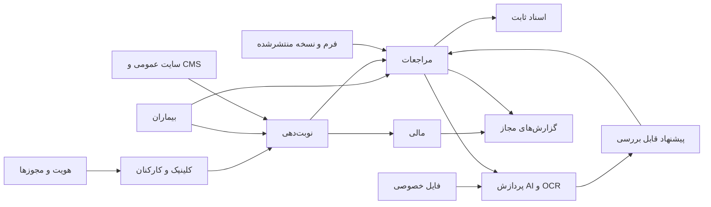

# تحلیل نیازمندی‌ها و معماری پیشنهادی

## محدوده و تصمیم‌های اصلی

محصول برای یک کلینیک چندتخصصی با چند پزشک، منشی، دستیار و بیمار طراحی می‌شود. پشتیبانی از چند شعبه مستقل یا SaaS چندمستاجری در محدوده فعلی نیست؛ با این حال مشخصات کلینیک در جدول مستقل قرار می‌گیرد. زبان پیش‌فرض فارسی، جهت RTL، تقویم نمایشی شمسی و منطقه زمانی نمایشی Asia/Tehran است.

معماری پیشنهادی **Modular Monolith** با Laravel، MySQL و Blade + Alpine.js + Tailwind CSS است. این انتخاب استقرار LAN و اینترنت، احراز هویت مبتنی بر session و نگهداری پروژه را ساده می‌کند. برای فرم‌ساز از اجزای JavaScript و SortableJS استفاده می‌شود. APIهای نسخه‌دار فقط برای تعاملات لازم ساخته می‌شوند؛ اگر بعداً کلاینت مستقل لازم شد از Laravel Sanctum استفاده خواهد شد.

نسخه هدف اولیه PHP 8.4 و MySQL 8.4 LTS است. نسخه پایدار Laravel و سازگاری وابستگی‌ها هنگام مرحله اول بررسی و سپس قفل می‌شوند؛ شماره نسخه بدون بررسی registry قطعی نیست. Node.js نسخه LTS سازگار با Vite انتخاب می‌شود.

دو تصمیم غیرقابل تعویق عبارت‌اند از نسخه‌بندی تغییرناپذیر فرم‌های منتشرشده و استقلال منطق پزشکی از Providerهای AI. این‌ها از همین طراحی در روابط دیتابیس لحاظ شده‌اند.

## تحلیل حوزه‌ها

| حوزه | نیازمندی و قاعده اصلی |
|---|---|
| هویت و دسترسی | کاربران، نقش‌های قابل توسعه، مجوز عملیاتی، نشست‌ها، دسترسی مبتنی بر انتساب پزشک و محدودیت فیلد |
| کارکنان | پزشکان با نظام پزشکی، تخصص، خدمات، ساعات حضور و تعرفه؛ انتساب چندبه‌چند منشی و دستیار |
| بیماران | اطلاعات اجباری هویتی، اعتبارسنجی ملی و موبایل، تشخیص تکرار، تماس اضطراری، بیمه و سوابق |
| فرم‌ساز | انواع فیلد موردنیاز، بخش‌بندی، چندستونی، جابه‌جایی، پیش‌نمایش، شرط، محاسبه، اشتراک و نسخه‌بندی |
| نوبت‌دهی | برنامه و تعطیلات، ظرفیت، رزرو دستی و آنلاین، جلوگیری تراکنشی از تداخل، صف و وضعیت حضور |
| پرونده | مراجعه وابسته به نسخه فرم، ثبت‌کننده و اصلاح‌کننده، سوابق، فایل خصوصی و تأیید پزشک |
| AI | چند Provider و مدل، Task مستقل، Prompt نسخه‌دار، تنظیم پزشک و فیلد، مصرف، پیشنهاد و تأیید انسانی |
| OCR و صوت | اصل فایل، پردازش صفحه‌ای، متن واقعی جدا از استخراج و تفسیر، امکان اصلاح و منشأ داده |
| اسناد | TXT، MD، HTML و PDF فارسی، قالب اختصاصی نسخه‌دار، snapshot سند و پیش‌نمایش |
| مالی | تعرفه، فاکتور، تراکنش، تأیید سمت سرور، بازپرداخت و گزارش |
| سایت و CMS | معرفی کلینیک و پزشک و خدمات، صفحات، مقالات، گردش بررسی، نویسندگان، SEO و رزرو آنلاین |
| گزارش | داشبورد متناسب با نقش، آمار عملیاتی، مالی و مصرف AI با اعمال مجوز قبل از تجمیع |
| عملیات | audit، مدیریت خطا، پشتیبان فایل و دیتابیس، آزمون بازیابی و استقرار LAN/اینترنت |

## لایه‌های نرم‌افزار

مسیر درخواست: Route → Middleware → FormRequest → Controller → Action/Service → Model/Query → Resource/View.

- Controller سبک و مسئول دریافت درخواست و پاسخ است.
- قواعد حوزه و تراکنش‌ها در Actionها قرار می‌گیرند؛ Policy دسترسی به رکورد و فیلد را کنترل می‌کند.
- مدل‌های Eloquent روابط و persistence را نگه می‌دارند. Repository عمومی برای هر جدول اضافه نمی‌شود.
- رویدادهای حوزه پس از commit منتشر می‌شوند. کارهای OCR، صوت، AI و تولید PDF سنگین در queue اجرا می‌شوند.
- رابط‌ها در محل مرز خارجی، مانند AI، پرداخت، ذخیره فایل و OCR قرار می‌گیرند.
- ورودی و خروجی هر ماژول DTO مشخص دارد؛ کنترلر یک ماژول مستقیماً منطق ماژول دیگر را بازنویسی نمی‌کند.
- قابلیت‌های خارجی دارای timeout، retry محدود، idempotency و وضعیت شکست قابل مشاهده هستند.

## ساختار پوشه‌ها در مرحله اجرا

```text
app/
  Modules/
    Identity/          # کاربران، نقش‌ها و نشست‌ها
    Clinic/            # مشخصات، خدمات و کارکنان
    Patients/          # هویت و سوابق عمومی
    Forms/             # طراحی، نسخه‌ها و اعتبارسنجی schema
    Scheduling/        # تقویم، ظرفیت و نوبت
    Encounters/        # مراجعه و مقادیر پزشکی
    Files/             # فایل خصوصی و پردازش
    AI/                # Provider، Task، Prompt و پیشنهاد
    Documents/         # قالب و خروجی ثابت
    Billing/           # فاکتور و پرداخت
    Content/           # سایت و وبلاگ
    Reports/           # Queryهای مجاز آمار
    Audit/             # تاریخچه فعالیت و تغییر
  Shared/              # فقط اجزای واقعاً مشترک
  Providers/
bootstrap/
config/
database/{migrations,factories,seeders}/
resources/
  views/{layouts,components,modules,public}/
  css/
  js/{forms,scheduling,shared}/
lang/{fa,en}/
routes/{web,api,console}.php
storage/app/private/
tests/{Unit,Feature,Integration}/
docs/
```

در هر ماژول فقط پوشه‌های موردنیاز مانند Models، Actions، Policies، Http، DTOs، Events، Jobs و Contracts ساخته می‌شوند. مسیرها در ابتدا در فایل‌های استاندارد Laravel گروه‌بندی می‌شوند. شاخه‌ها و کلاس‌های خالی از پیش تولید نمی‌شوند.

## رابطه ماژول‌ها



Identity و Audit به‌صورت مشترک روی مرزهای همه ماژول‌ها اعمال می‌شوند. سایت عمومی فقط اطلاعات منتشرشده را می‌خواند و از همان سرویس رزروِ پنل داخلی استفاده می‌کند. دسترسی مستقیم عمومی به جدول‌های پزشکی وجود ندارد.

## امنیت و مرزبندی اطلاعات

- RBAC مبتنی بر spatie/laravel-permission به همراه Policyهای انتساب پزشک و مجوزهای فیلد؛ نقش به‌تنهایی برای اجازه دسترسی کافی نیست.
- پزشک فقط بیماران و مراجعات مجاز را می‌بیند. انتساب دستیار و منشی بازه اعتبار دارد و حذف انتساب باید فوراً دسترسی آینده را قطع کند.
- فهرست، جستجو، export، queue job، API و داشبورد نیز باید scope یکسان داشته باشند. پنهان‌سازی UI کنترل دسترسی محسوب نمی‌شود.
- ثبت‌نام عمومی کارکنان بسته است. احراز هویت session، هش استاندارد، CSRF، محدودسازی ورود، بازتولید session و خروج از نشست‌ها در مرحله اول انجام می‌شود. تأیید دومرحله‌ای برای حساب‌های مدیریتی پیش از استقرار در نظر گرفته می‌شود.
- فایل‌ها خارج از public ذخیره و فقط پس از Policy با stream یا URL کوتاه‌عمر تحویل می‌شوند. MIME واقعی، حجم و مالکیت بررسی می‌شود؛ فایل پردازشی در محیط محدود اجرا می‌شود.
- لاگ خطای عمومی شامل متن پرونده، توکن، فایل یا payload پزشکی نمی‌شود. Audit حساس با دسترسی و مدت نگهداری مجزا است.
- API keyهای AI و پرداخت به‌صورت encrypted cast با کلید سرور نگهداری می‌شوند. کلید رمزنگاری جدا از backup داده و با فرآیند بازیابی محافظت می‌شود.
- اصلاح رکورد نهایی با amendment امضاشده و تاریخچه انجام می‌شود. حذف نرم به‌تنهایی جایگزین سیاست قانونی نگهداری نیست.
- پیش از استفاده واقعی، محل استقرار و الزامات قانونی مربوط به رضایت، انتقال برون‌مرزی داده و مدت نگهداری باید مشخص شود. این موارد مانع طراحی و توسعه محلی نیستند.

## زمان، زبان و ظاهر

تاریخ تولد با DATE میلادی و رویدادها با زمان UTC ذخیره می‌شوند. نمایش و ورودی شمسی از طریق کتابخانه معتبر مانند morilog/jalali و آزمون نوروز و سال کبیسه انجام می‌شود. ساعات تکرارشونده پزشک با زمان محلی و timezone برنامه نگهداری و در رزرو به UTC تبدیل می‌شوند؛ offset ثابت برای تهران hardcode نمی‌شود.

زبان و تم light/dark/system در تنظیمات کاربر ذخیره می‌شود. تغییر زبان نباید صفحه دارای داده ذخیره‌نشده را reload کند. متن‌ها کلید ترجمه دارند، CSS از logical properties استفاده می‌کند و فونت Vazirmatn به‌صورت محلی سرو می‌شود تا LAN به CDN وابسته نباشد. جدول‌ها، modal، loading، empty و error state جزو معیار پذیرش رابط‌اند.

## LAN، اینترنت و حالت بدون اینترنت

| قابلیت | LAN بدون اینترنت | اینترنت |
|---|---|---|
| کاربران، بیمار، پرونده، فرم و نوبت دستی | قابل استفاده روی سرور روشن محلی | قابل استفاده |
| فایل و PDF و گزارش | محلی با ابزار نصب‌شده | قابل استفاده |
| OCR و AI محلی | در صورت نصب موتور و منابع کافی | قابل استفاده |
| AI ابری، پیامک و درگاه | غیرفعال یا خطای قابل بازیابی | وابسته به سرویس |
| رزرو عمومی | فقط داخل LAN | از سایت منتشرشده |

مرورگر برای کار آفلاین روی دستگاه جدا از سرور طراحی نمی‌شود. قطع اینترنت با قطع شبکه داخلی تفاوت دارد؛ در قطع LAN، کلاینت به سرور دسترسی ندارد. نصب هم‌زمان دو دیتابیس محلی و ابری و همگام‌سازی آن‌ها در محدوده فعلی نیست.

برای هر استقرار یک دیتابیس مرجع وجود دارد. استقرار اینترنتی HTTPS و reverse proxy دارد؛ دیتابیس روی شبکه خصوصی می‌ماند. دسترسی بیرونی به سرور LAN از VPN یا تونل امن به وب‌سرور انجام می‌شود. ابزار توسعه `artisan serve` سرور تولید محسوب نمی‌شود.

## کیفیت، پشتیبان و مقیاس

شروع با queue و session دیتابیسی امکان‌پذیر است؛ Redis در صورت نیاز بار واقعی اضافه می‌شود. چند worker برای پردازش سنگین و محدودیت اندازه فایل در نظر گرفته می‌شود. pagination، index، محدودکردن payload و جلوگیری از N+1 از ابتدا اعمال می‌شوند.

پشتیبان رمزنگاری‌شده شامل دیتابیس، فایل خصوصی و نسخه قالب‌ها است؛ کلیدها جدا حفاظت می‌شوند. job پشتیبان و آزمون بازیابی در محیط جدا پیش از استقرار الزامی است. هدف اولیه پیشنهادی RPO حداکثر ۲۴ ساعت و RTO حداکثر ۴ ساعت است و پیش از تولید با حجم واقعی و نیاز کلینیک نهایی می‌شود.

تست و کنترل امنیت در تمام مراحل اجرا می‌شوند؛ مرحله پایانی برای آزمون جامع و استقرار است. نرخ خطا، وضعیت queue و سلامت وابستگی‌ها بدون انتشار داده پزشکی پایش می‌شوند.
