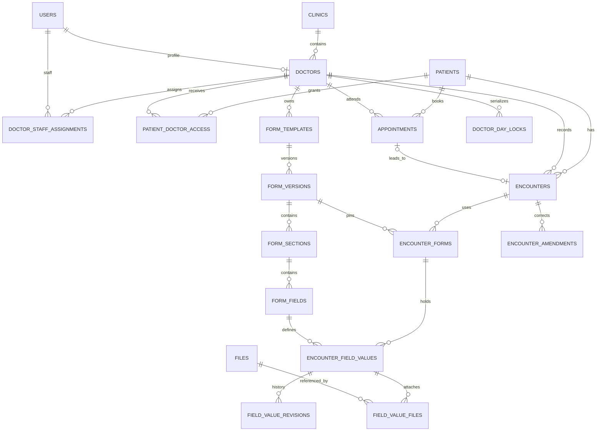
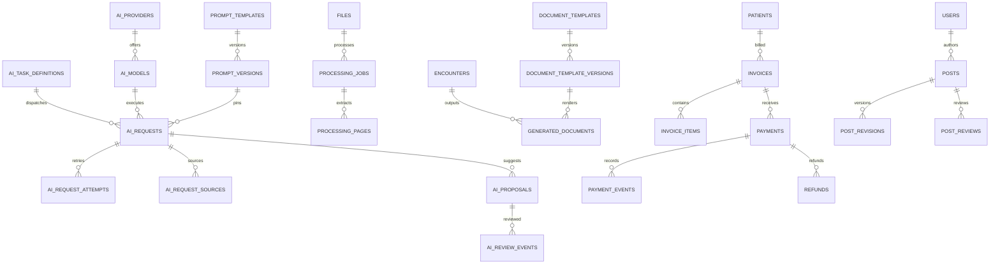

# طراحی اولیه دیتابیس و ERD

این سند طرح منطقی است؛ migrationها در مراحل مربوط ایجاد می‌شوند. نام‌ها ممکن است هنگام پیاده‌سازی با حفظ روابط اصلاح شوند. جدول‌های زیر موجود یا ساخته‌شده نیستند.

## قراردادهای عمومی

- MySQL 8.4 LTS، InnoDB، charset برابر utf8mb4 و کلید داخلی BIGINT. برای لینک‌های عمومی شناسه ULID مستقل استفاده می‌شود؛ حدس‌ناپذیری شناسه جایگزین مجوز نیست.
- ستون‌های عمومی: `id`, `created_at`, `updated_at`؛ برای رکوردهای بالینی `created_by`, `updated_by` و در موارد مناسب `deleted_at`. جدول‌های نسخه منتشرشده و تاریخچه، immutable هستند.
- FKهای پزشکی با RESTRICT حفظ می‌شوند. cascade فقط برای داده‌های وابسته غیرتاریخی مانند pivotهای مجوز و draft مجاز است.
- زمان رویدادها UTC با دقت میکروثانیه و تاریخ تولد DATE است. مبالغ `BIGINT` به ریال، همراه `currency=IRR` و بدون float ذخیره می‌شوند؛ نمایش تومان تبدیل صریح دارد.
- کد ملی و موبایل string هستند؛ صفر ابتدا حفظ می‌شود. ارقام فارسی و عربی قبل از اعتبارسنجی normalize می‌شوند.
- JSON برای schema، گزینه‌ها و payload انعطاف‌پذیر است؛ کلیدهای رابطه‌ای، مجوز و داده قابل جستجوی اصلی در ستون‌های معمولی قرار می‌گیرند.

## هویت، کارکنان و بیماران

| جدول | ستون‌ها و قیود مهم |
|---|---|
| clinics | name، slug UNIQUE، timezone، contact، settings_json |
| users | name، email UNIQUE nullable، mobile UNIQUE nullable، password، active، locale، theme، last_login_at؛ حداقل یک شناسه ورود الزامی |
| roles / permissions | name + guard_name UNIQUE؛ مطابق schema کتابخانه RBAC |
| model_has_roles / model_has_permissions / role_has_permissions | pivotهای استاندارد کتابخانه، کلید ترکیبی یکتا |
| sessions / password_reset_tokens | نشست و بازیابی استاندارد Laravel |
| specialties | name_fa، name_en، parent_id nullable |
| doctors | user_id UNIQUE FK، clinic_id FK، medical_council_number UNIQUE، bio، photo_file_id nullable، visit_duration_minutes، active |
| doctor_specialty | doctor_id + specialty_id UNIQUE، is_primary |
| doctor_staff_assignments | doctor_id، staff_user_id، assignment_type receptionist/assistant، starts_at، ends_at، assigned_by؛ index روی پزشک و کاربر و اعتبار |
| services | clinic_id، name، description، default_price_rial، active |
| doctor_services | doctor_id + service_id UNIQUE، duration_minutes، price_rial، active |
| patients | public_id UNIQUE، clinic_id، first_name، last_name، national_id CHAR(10) UNIQUE، mobile VARCHAR(16) INDEX، birth_date، sex، email، address، occupation، marital_status، referral_source، photo_file_id nullable |
| patient_contacts | patient_id، name، relationship، mobile، is_emergency |
| patient_insurances | patient_id، insurer، policy_number، expires_on |
| patient_history_entries | patient_id، category، description، recorded_by، recorded_at، supersedes_id nullable؛ انواع بیماری، جراحی، بستری، آلرژی، دارو، خانوادگی و اجتماعی |
| patient_doctor_access | patient_id + doctor_id UNIQUE، access_level، granted_by، starts_at، ends_at، source_encounter_id nullable |
| patient_user_links | patient_id + user_id UNIQUE، verified_at؛ برای حساب بیمار و نماینده مجاز در مراحل عمومی |

تکرار کد ملی در سطح دیتابیس مسدود می‌شود. موبایل بیمار UNIQUE نیست چون خانواده ممکن است شماره مشترک داشته باشد؛ سیستم اخطار تکرار و پیشنهاد پرونده موجود می‌دهد. اتصال یا ادغام پرونده صرفاً با تأیید کاربر مجاز و audit انجام می‌شود. منشی تنها اطلاعات هویتی و عملیاتی مجاز را دریافت می‌کند. تأیید موبایل به‌تنهایی مجوز دیدن پرونده موجود نیست.

## فرم‌ها، مراجعه و مقادیر

| جدول | ستون‌ها و قیود مهم |
|---|---|
| form_templates | owner_doctor_id، name، status، default برای نوع فرم از طریق doctor_form_defaults؛ archived_at |
| form_versions | form_template_id، version_number، status draft/published، schema_json، schema_hash، published_at، published_by؛ UNIQUE(template, version_number) |
| form_sections | form_version_id، section_key، title_json، position، columns؛ UNIQUE(version, section_key) |
| form_fields | form_version_id، form_section_id، parent_field_id nullable، field_key، type، label_json، config_json، validation_json، condition_json، ai_config_json، confidentiality، assistant_editable، receptionist_visible، exportable، position؛ UNIQUE(version, field_key) |
| doctor_form_defaults | doctor_id + form_purpose UNIQUE، form_template_id |
| form_template_shares | form_template_id + recipient_doctor_id UNIQUE، can_copy، granted_by؛ اشتراک قالب بدون داده بیمار |
| encounters | patient_id، doctor_id، appointment_id nullable UNIQUE، status، started_at، finalized_at، finalized_by |
| encounter_forms | encounter_id، form_version_id، status، created_by، finalized_at؛ UNIQUE(encounter, version) |
| encounter_field_values | encounter_form_id، form_field_id، item_path، value_json، origin manual/import/ai، recorded_by، reviewed_by nullable، source_ai_proposal_id nullable؛ UNIQUE(encounter_form, field, item_path) |
| field_value_revisions | field_value_id، revision، previous_value_json، new_value_json، actor_id، reason، source_json، recorded_at؛ UNIQUE(value, revision) |
| encounter_amendments | encounter_id، reason، content_json، author_id، signed_at؛ اصلاح پس از نهایی‌سازی بدون بازنویسی سابقه |

`schema_json` snapshot استاندارد کامپایل‌شده از بخش‌ها و فیلدها در زمان انتشار است؛ draft از جداول بخش و فیلد ویرایش می‌شود. پس از انتشار تمام رکوردهای نسخه ثابت‌اند. schema و جداول منتشرشده فقط در یک تراکنش و با hash سازگار تولید می‌شوند؛ دو منبع مستقل قابل ویرایش نخواهند بود.

`item_path` برای فیلد عادی رشته خالی و برای repeater مسیر شناسه پایدار ردیف‌هاست. ارجاع field باید متعلق به همان form_version مراجعه باشد؛ FK ساده کافی نیست و invariant در Action و تست تراکنش کنترل می‌شود. فیلد دارای چند فایل با جدول واسط فایل متصل می‌شود، نه URL دلخواه در value.

## برنامه، نوبت و صف

| جدول | ستون‌ها و قیود مهم |
|---|---|
| doctor_schedule_rules | doctor_id، weekday، local_start، local_end، timezone، effective_from، effective_to، slot_minutes، capacity |
| schedule_exceptions | doctor_id، local_date، kind closed/override/break، start_time، end_time، reason |
| doctor_day_locks | doctor_id + local_date UNIQUE؛ رکورد هماهنگی برای قفل تراکنشی رزرو |
| appointments | public_id UNIQUE، patient_id، doctor_id، doctor_service_id، starts_at، ends_at، status، booking_source، created_by، override_by nullable، override_reason nullable، tracking_code UNIQUE |
| appointment_holds | doctor_id، starts_at، ends_at، token_hash UNIQUE، expires_at، patient_id nullable، status؛ رزرو موقت پرداخت آنلاین |
| appointment_status_events | appointment_id، from_status، to_status، actor_id، reason، occurred_at |
| waitlist_entries | patient_id، doctor_id، preferred_from، preferred_to، status، priority، created_by |
| queue_entries | appointment_id UNIQUE، doctor_id، checked_in_at، called_at، completed_at، queue_number |

index اصلی نوبت روی `(doctor_id, starts_at, ends_at, status)` است. یک UNIQUE روی ساعت شروع برای جلوگیری از تداخل بازه‌های متفاوت کافی نیست. تمام مسیرهای رزرو، تغییر، لغو و callback از سرویس مشترک استفاده می‌کنند: قفل سطر doctor_day_locks با `SELECT FOR UPDATE`، بررسی بازه‌های فعال و holdهای منقضی‌نشده، سپس ثبت در تراکنش. برای بازه عبوری از نیمه‌شب، قفل روزها با ترتیب ثابت گرفته می‌شود. ظرفیت به‌صورت صریح محاسبه می‌شود؛ تجاوز نیازمند مجوز مدیریتی و دلیل auditشده است.

## فایل، پردازش و هوش مصنوعی

| جدول | ستون‌ها و قیود مهم |
|---|---|
| files | public_id UNIQUE، disk، private_path، original_name، detected_mime، size_bytes، checksum، uploaded_by، patient_id nullable، encounter_id nullable، scan_status |
| field_value_files | field_value_id + file_id UNIQUE، position |
| processing_jobs | file_id، kind ocr/stt/extract، engine، status، page_count، error_code، requested_by، started_at، completed_at |
| processing_pages | processing_job_id + page_number UNIQUE، raw_text، corrected_text nullable، metadata_json؛ متن حساس با حفاظت ذخیره‌سازی |
| ai_providers | name، adapter_type، base_url، api_key_encrypted، timeout_seconds، enabled، last_health_status |
| ai_models | provider_id + model_name UNIQUE، capabilities_json، context_limit، input_cost، output_cost، enabled |
| ai_task_definitions | task_key UNIQUE، required_capabilities_json، output_schema_json، default_model_id، fallback_model_id nullable، enabled |
| ai_doctor_settings | doctor_id + task_definition_id UNIQUE، allowed، model_id nullable، prompt_version_id nullable، settings_json |
| ai_module_settings | module_key + task_definition_id UNIQUE، enabled، settings_json |
| prompt_templates | name، task_definition_id، owner_doctor_id nullable، scope، active |
| prompt_versions | prompt_template_id + version_number UNIQUE، system_text، user_template، input_language، output_language، output_schema_json، published_at، created_by |
| ai_requests | public_id UNIQUE، requester_id، doctor_id nullable، patient_id nullable، encounter_id nullable، task_definition_id، model_id، prompt_version_id، form_version_id nullable، status، idempotency_key UNIQUE، input_tokens، output_tokens، estimated_cost، requested_at، completed_at، error_code |
| ai_request_attempts | ai_request_id، attempt_number، model_id، provider_id، status، duration_ms، usage_json، error_code؛ UNIQUE(request, attempt) |
| ai_request_sources | ai_request_id، file_id nullable، processing_page_id nullable، field_value_revision_id nullable، selected_text_encrypted nullable، content_hash |
| ai_proposals | ai_request_id، encounter_form_id nullable، form_field_id nullable، proposed_value_json، evidence_json، status pending/accepted/rejected/stale، reviewed_by، reviewed_at، base_revision nullable |
| ai_review_events | ai_proposal_id، decision، reviewer_id، edited_value_json nullable، reason، occurred_at |

حفظ ورودی و خروجی حساس AI با مدت نگهداری مستقل انجام می‌شود؛ payload در log عمومی ذخیره نمی‌شود. برای منشأ قابل اعتماد، sourceها باید به نسخه محتوا یا hash فایل ارجاع دهند. مقادیر هزینه AI به‌صورت DECIMAL با واحد پول سرویس ثبت می‌شوند؛ با مبلغ صورتحساب ریالی ترکیب مستقیم نمی‌شوند.

## اسناد، مالی و محتوا

| جدول | ستون‌ها و قیود مهم |
|---|---|
| document_templates | owner_doctor_id، form_template_id nullable، purpose، name، active |
| document_template_versions | template_id + version_number UNIQUE، layout_json، allowed_field_keys_json، font، page_settings_json، published_at |
| generated_documents | encounter_id، document_template_version_id، form_version_id، format، immutable_snapshot_json، file_id nullable، checksum، generated_by، signed_at nullable |
| invoices | patient_id، appointment_id nullable، encounter_id nullable، number UNIQUE، status، currency، total_rial، issued_at |
| invoice_items | invoice_id، service_id nullable، description_snapshot، quantity، unit_price_rial، total_rial |
| payment_gateways | name، adapter_type، credentials_encrypted، enabled |
| payments | invoice_id، gateway_id nullable، method، amount_rial، status، merchant_order_id UNIQUE، gateway_reference nullable UNIQUE، idempotency_key UNIQUE، verified_at |
| payment_events | payment_id، event_type، sanitized_payload_json، occurred_at؛ بدون اطلاعات بانکی محرمانه |
| refunds | payment_id، amount_rial، reason، status، reference nullable، approved_by |
| pages | slug UNIQUE، title_json، body_sanitized، status، seo_json، published_at |
| posts | author_id، slug UNIQUE، title، body_sanitized، featured_file_id nullable، status، scheduled_at، published_at، seo_json |
| post_revisions | post_id، revision، content_json، editor_id، created_at |
| post_reviews | post_id، reviewer_id، decision، reason، reviewed_at |
| categories / tags | name، slug UNIQUE |
| category_post / post_tag | زوج FK یکتا |
| media_placements | file_id، page_id/post_id nullable، placement، position |
| contact_messages | name، mobile/email، message، status؛ rate limit و نگهداری محدود |
| otp_challenges | identifier_hash، code_hash، purpose، expires_at، attempts، consumed_at |
| audit_events | actor_id nullable، action، subject_type، subject_id، changed_keys_json، sensitive_diff_encrypted nullable، request_id، occurred_at؛ append-only |
| backup_runs | status، storage_reference، started_at، completed_at، checksum، restore_verified_at، error_code |

رزرو موقت پس از تأیید سرور درگاه و با قفل همان روز پزشک قطعی می‌شود. callback تکراری نباید پرداخت یا نوبت دوباره بسازد. اگر پس از پرداخت معتبر ظرفیت از دست رفته باشد، وضعیت نیازمند رسیدگی/بازپرداخت ثبت می‌شود؛ نوبت متداخل ساخته نمی‌شود. پرداخت دستی هم نیازمند مجوز و ثبت‌کننده است.

## ERD هسته

برای خوانایی، ERD در دو نمودار آمده است؛ جزئیات ستون‌ها و جدول‌های فرعی در فرهنگ داده بالاست.

## قیود پذیرش دیتابیس

آزمون‌های یکپارچگی رزرو باید روی MySQL واقعی اجرا شوند؛ SQLite رفتار قفل و رقابت را نمایندگی نمی‌کند. migrationها و rollbackهای توسعه تست می‌شوند؛ تغییر ساختار جدول‌های دارای داده با migration سازگار و backup انجام می‌شود. schema نهایی هر حوزه قبل از کدنویسی همان مرحله با این طرح تطبیق داده می‌شود.
